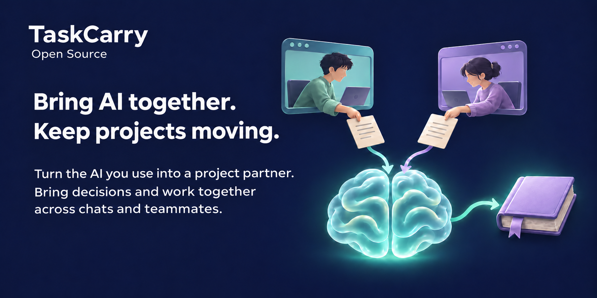
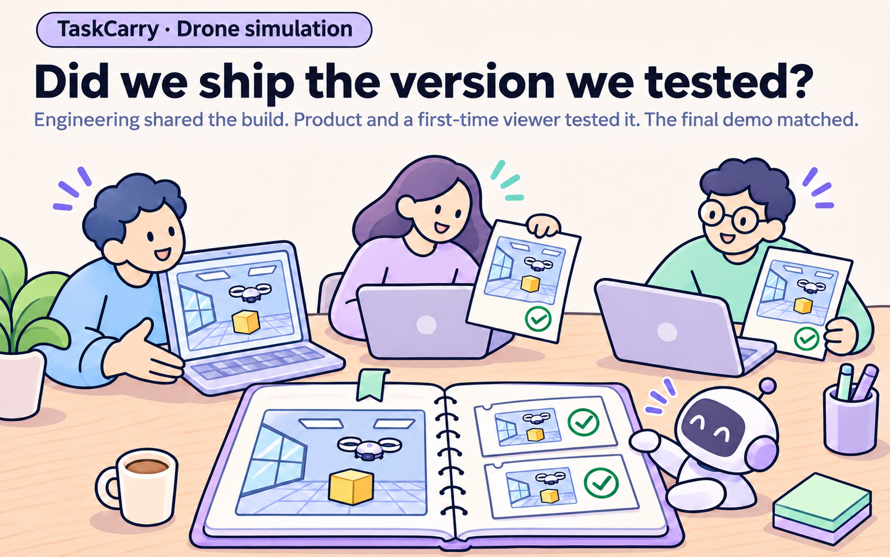
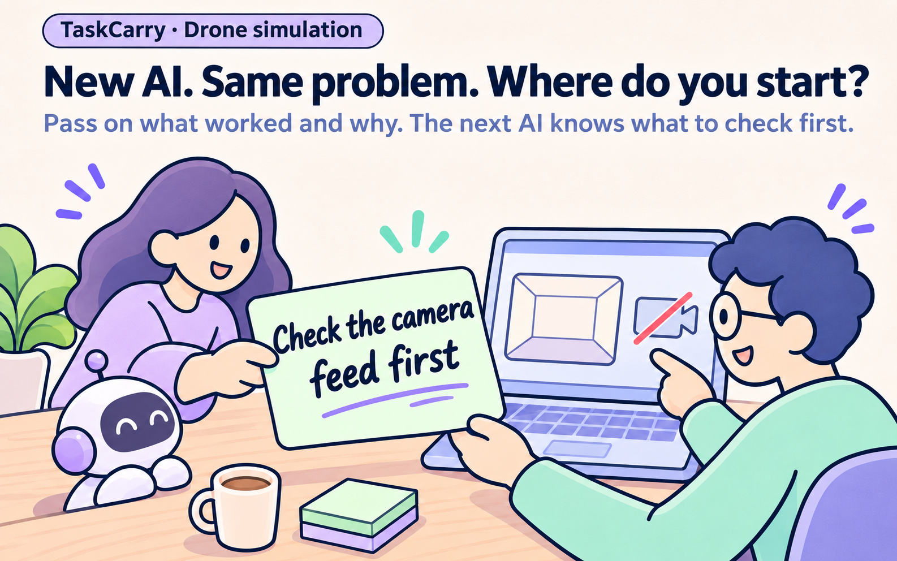

# TaskCarry

[English](README.md) · [简体中文](README.zh-CN.md) · [繁體中文](README.zh-TW.md)

**Bring AI together. Keep projects moving.**

TaskCarry brings decisions and work from your team’s AI chats into one lasting project record.

[Download the complete package and get started](START_HERE.md#download) · [Update an existing project](docs/en/updating.md)

## What can TaskCarry do for your project?

### Which version should I send?

You update the demo in one chat. A teammate tries it with their own AI and messages you, “This one’s ready to send.” Two days later, which file did they mean? Ask your project manager. It can pull up the demo they actually tested, along with their feedback.

### Who’s tried this before? What worked?

The last time a teammate tested the drone demo, they left a note: “Check the camera feed first.” Now you’re reviewing a new build with a different AI, and the screen is blank again. Your manager finds that note. You know to check whether a picture came through before deciding the way is clear.

### Switch AI tools and pick up where you left off.

You’re halfway through the demo guide and want another AI to finish it. Ask the new manager to pick up the guide. It can find the draft you saved in the last chat, the demo version everyone agreed on, and the step your teammate marked as missing. Hand over just the guide, or ask it to manage the whole project.

[Release notes and workflows exercised](docs/RELEASE_0.2.0rc9.md#en)

## Why add TaskCarry to Git and project instructions?

Git already keeps file history. Project instructions such as AGENTS.md already explain how an AI assistant should work. A handoff message already helps the next conversation get started. TaskCarry connects these useful pieces to the changing state of a project.

| What you already use | What it helps with | What TaskCarry adds |
|---|---|---|
| Git | Versions, branches, and file changes | Which task a result belongs to, which stage was received, and what still needs to continue. |
| AGENTS.md and Skills | Working practices and role instructions | Persistent records of the work actually saved, offered, integrated, or paused. |
| Conversation summaries | Context for a person or another chat | Task records and file references you can update and revisit beyond one conversation. |
| Manual handoffs | Coordination between a few workstreams | Reviewed plans, recorded operation results, and supported recovery when work is interrupted. |

For a short task in one chat, your existing tools may be enough. TaskCarry becomes useful when you repeatedly need to answer: **Where did we stop? Which result is current? What has already joined the project?**

## Remember the project. Coordinate results. Govern progress.

### Remember the project

Keep task goals, recorded decisions, current position, and next steps outside chat context. Save selected files and continuation notes when a task pauses, and read a focused agenda without losing paused work or completed history. Material references record where larger files live and whether a specified backup matches, so every file need not go into Git.

**A chat can stop without the project starting over.** Governance can guide a replacement chat to the original task, saved decisions and results, without requiring a spare chat in advance. First stop the old writer and verify the new chat's connection and task; continuation depends on saved work and cannot repair the host or recover unsaved context. See [the continuation workflow](docs/en/operation-manual.md).

### Coordinate results

Give parallel tasks independent workspaces, then bring ready results into a shared project version. A useful stage can be delivered while its task continues. Explicit version relationships and matching change history show when a later stage replaces an earlier one, while keeping independent results available.

### Govern how the project moves forward

Project workflow governance connects the work people and AI produce with clear plans, checked updates, and recorded outcomes.

| Capability | What it helps you do |
|---|---|
| **Understand connected work** | Review selected source revisions, distinguish facts from judgments, and retain decisions and dependencies without reopening finished history. |
| **Keep working chats aligned** | Publish versioned private workbench guidance, preserving professional instructions and Git WIP; distinguish publication from actual consumption. |
| **Govern a complete cycle** | Retain ownership, intended effects, actual results and continuation points; use a morning report and quieter absorption slots. |
| **Receive exact stages** | Review commits, changed paths and task relationships, then integrate the stage's files into the receiving baseline. Update selected workspaces through a separate plan that preserves supported local work. Business acceptance remains your decision. |
| **Recover selected project work** | Verify consistent state/objects, original Git history and layered WIP, explicit materials and standby recovery before a sole-writer handoff. |
| **Maintain with evidence** | Link problems to verified fixes, distinguish update discovery from installation, and report source, native-host and natural-trigger evidence separately. |

This governance focuses on project deliverables and their workflow. Host permissions and Agent authentication remain with your AI platform and operating environment; [the architecture](docs/en/architecture.md) explains how these responsibilities fit together.

Memory comes from the tasks, notes, files, and deliveries you or your AI assistant explicitly connect. TaskCarry does not automatically collect all private conversations or capture unsaved editor content.

## How people, AI, and tools work together

Your independent **governance chat** maintains project memory and reviews connected progress. It uses the host AI to understand permitted sources, distinguish confirmed decisions from suggestions, and call TaskCarry tools. It can also coordinate project priorities if you choose. Keep giving work directly to your existing main or specialist chats; governance does not become a required dispatch gate.

The product has three responsibility layers: **Core** supplies verifiable shared operations; the **capability layer** combines packaged Skills, project methods and available host tools; the **user project layer** retains your facts, decisions, relationships, files and progress. Public updates preserve your project rules and memory. Core can be reinstalled, but restoring your project requires its actual state, objects, Git history/WIP, materials and capability versions. See [how the three layers work together](docs/en/architecture.md).

Engine code, governance methods and project data have separate lifecycles: supported engine updates retain original tasks and historical relationships, while your own governance methods can be validated and adopted independently of public releases.

TaskCarry stores records and performs the supported local operations. You retain decisions about project direction, priorities, business acceptance, and external delivery. The toolkit does not require a separate model API or train a model.

For example, software may have a usable module while experiments are paused and documentation is still a draft. Governance can receive the software stage and retain the other two tasks at their current positions. Nobody needs to mark the entire project complete just to preserve useful progress.

## The everyday workflow

Governance keeps decisions, dependencies and current guidance aligned while you work in your existing chats. The following flow applies when a stable set of Git changes is ready to join the shared project; an ordinary progress update does not require a delivery or code merge.

1. **Work in your task chat.** Continue the real task in its assigned workspace.
2. **Save a useful stopping point.** Record the current position and selected files when you pause.
3. **Offer a ready result.** Identify the stable version and the files it changes.
4. **Bring it into the project.** The governance chat reviews a plan and receives the stage through the tools.
5. **Continue from shared progress.** Update the workspaces that need those business changes, preserving supported local work and addressing concrete conflicts.

A received stage can be part of an unfinished task. A paused task can stay paused. Replacing an older stage requires a documented relationship and matching change history, so independent results are not discarded merely because a newer file exists.

## Install or update TaskCarry

### First time using TaskCarry

[Get the complete product package](START_HERE.md#download), then follow the [three-step guide](docs/en/windows-example.md):

1. **Start a project manager chat.** Extract the ZIP into an empty folder. Follow the [folder-opening instructions and opening prompt](docs/en/windows-example.md#install) to start a manager chat using it. In Codex, select the folder with **Ctrl+O** on Windows or **⌘O (Command+O)** on Mac, then start a new chat using it.
2. **Invite your working chats.** The manager gives you a message to paste. Choose from the projects and chats it suggests, or skip the suggestions and paste the message into the chats you want to include. Once a chat joins, carry on working there. To add another chat later, ask the manager for the message and where to paste it. With scheduled checks on, the manager picks up new chats at its next check and tells you who joined. You can also ask “Which chats have joined?”
3. **Get to work and let the manager follow up.** Review the project overview and next steps, then continue in your working chats. Enable scheduled check-ins, and ask the manager to help set up private GitHub backups, collaboration with other AIs or computers, or project migration as needed. [See example feedback](docs/en/user-feedback-examples.md).

Keep working in your original chats. Governance maintains project memory; ongoing project coordination is optional, and you may need no additional specialist chats.

### Existing governance

(If TaskCarry is installed, another governance tool is in use, or you already have a governance chat, start with [update and continuation](docs/en/updating.md).) It distinguishes package updates from inheriting existing governance, preserving original records, settings and unfinished work.

If the host needs you to complete an action, the assistant supplies that one step. Detailed commands are in the [manual fallback](docs/en/manual-setup.md); changes between releases are in the [RC9 release notes](docs/RELEASE_0.2.0rc9.md#en).

This is an organization example. Existing working chats remain useful. If they share a directory, inspect active writers and preserve scoped WIP before arranging independent write areas.

For a concrete walkthrough, explore the [drone simulation and governance example](examples/vision-drone-governance/simulation/README.md). It connects scattered chats into software, algorithms, hardware engineering documents, independent testing and a product demonstration. Open the offline interface to see a rule-based detector read generated image pixels and guide movement through a 9 × 9 discrete 2D world. The example links its shared decisions, deliverables and verification evidence; it is a simulation prototype, with no real aircraft, flight testing or trained vision model.

## Build on the local workflow

- **Standard local governance:** local Git, workbench publication/consumption, a first complete cycle and recovery rehearsal, official release checking, and two or three daily original-chat slots: one report plus one or two absorption periods. Missing host steps stay explicit. A new release is evaluated before installation.
- **Private Git:** configure your own remote repository for selected committed results. File references help locate materials, but copying, backup, and remote synchronization remain explicit operations.
- **Additional AI tools:** AI tools that can launch a custom local stdio MCP server can try joining a project. Codex, WorkBuddy and Google Antigravity CLI running Gemini have each exercised specific workflows. A scoped web trial let Gemini read authorized project records over HTTPS.
- **Multiple computers:** Collaborators return selected results on task branches. The integration manager reviews which changes to adopt in the shared version. When moving computers, restore the project and review its state before transferring write authority. [Guide](docs/en/remote-and-multicomputer.md)

TaskCarry uses Python 3.11+ and includes four project Skills for setup, task delivery, governance, and recovery. Standard onboarding prepares local Git; the lower-level ability to checkpoint ordinary files remains available for compatibility and recovery. Each control scope has one local store and one receiving baseline; a user-defined project can connect multiple existing sources without silently merging them. Installation updates tools and Skills; adopting received business changes into a workspace is a separate, reviewed action. See [maintenance](docs/en/governance-maintenance.md) and [capabilities and limits](docs/RELEASE_BOUNDARIES.md).

## Documentation

| Guide | English | 简体中文 | 繁體中文 |
|---|---|---|---|
| Manual fallback | [Commands and handoffs](docs/en/manual-setup.md) | [手动后备](docs/zh-CN/manual-setup.md) | [手動後備](docs/zh-TW/manual-setup.md) |
| User manual | [Start here](docs/en/windows-example.md) | [从这里开始](docs/zh-CN/windows-example.md) | [從這裡開始](docs/zh-TW/windows-example.md) |
| Existing governance | [Update and continuation](docs/en/updating.md) | [更新与接续](docs/zh-CN/updating.md) | [更新與接續](docs/zh-TW/updating.md) |
| Feedback examples | [What users should hear](docs/en/user-feedback-examples.md) | [反馈示例](docs/zh-CN/user-feedback-examples.md) | [回饋範例](docs/zh-TW/user-feedback-examples.md) |
| Architecture | [How it works](docs/en/architecture.md) | [架构说明](docs/zh-CN/architecture.md) | [架構說明](docs/zh-TW/architecture.md) |
| Maintenance | [Maintain a project](docs/en/governance-maintenance.md) | [维护项目](docs/zh-CN/governance-maintenance.md) | [維護專案](docs/zh-TW/governance-maintenance.md) |
| Private Git and multiple computers | [Guide](docs/en/remote-and-multicomputer.md) | [说明](docs/zh-CN/remote-and-multicomputer.md) | [說明](docs/zh-TW/remote-and-multicomputer.md) |

[How the workflow became simpler](docs/en/governance-evolution.md)

[CLI / MCP reference](docs/COMMANDS.md) · [Public Skills](skills) · [Validation records](docs/RELEASE_0.2.0rc9.md)

## Join in

Questions, real use cases, clearer examples, translations, and code improvements are welcome. Start with [Issues](https://github.com/bryan123466/taskcarry/issues) or the [contribution guide](https://github.com/bryan123466/taskcarry/blob/main/CONTRIBUTING.md). Remove private project information before sharing; the [security guide](SECURITY.md) explains what to keep out of a report.

## License

The public code, documentation, templates, and examples use the [MIT license](LICENSE), including commercial reuse under its terms. Your own project and materials remain yours to manage; using TaskCarry does not make them public. Dependencies and services retain their own terms. See [license scope](LICENSE_SCOPE.md).
