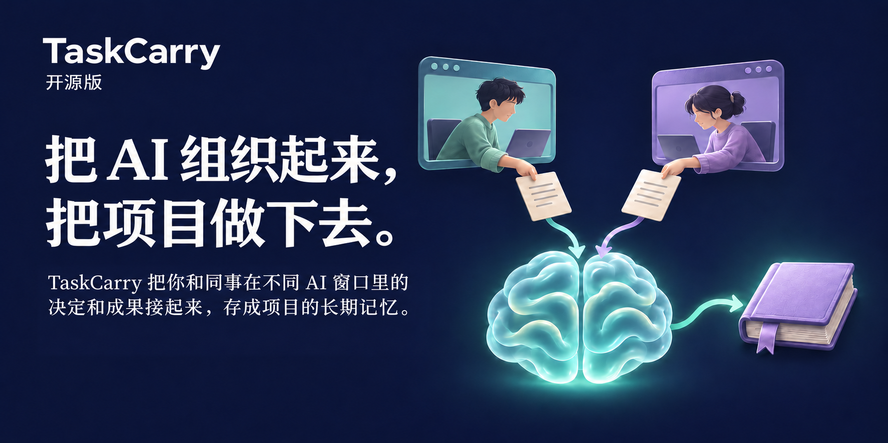

# TaskCarry

[English](README.md) · [简体中文](README.zh-CN.md) · [繁體中文](README.zh-TW.md)

**把 AI 组织起来，把项目做下去。**

TaskCarry 把你和同事在不同 AI 窗口里的决定和成果接起来，存成项目的长期记忆。

[下载完整包，三步开始](START_HERE.md#download) · [已有项目，更新与接续](docs/zh-CN/updating.md)

## TaskCarry 能帮你做什么

### 要交付了，到底该发哪一版？

你在一个窗口改好演示，同事用自己的 AI 试了一遍，回你一句“这版可以发”。过两天真要发给别人，“这版”是哪一份？问项目管家，它能把同事验过的那份演示和当时的反馈一起找回来。

### 这件事，哪个窗口已经做过了？

上次测试无人机演示，同事留了句提醒：“先确认有没有收到画面。”这次轮到你和另一个 AI 检查新版，屏幕上又是空的。管家找回那条提醒，你们就知道先查相机有没有传回画面，再判断前面有没有障碍。

### 换个 AI，从上次停下的地方继续

演示指南写了一半，你想换个 AI 帮忙收尾。告诉新管家“接着写这份指南”，它能从项目记录里找到上个窗口保存的草稿、大家最后选的演示版本，以及同事标出来要补的那一步。你可以只交给它这份指南，也可以让它接着管整个项目。

[本版更新与已演练的工作流程](docs/RELEASE_0.2.0rc9.md#zh-cn)

## 已经有 Git 和项目指令，为什么还需要 TaskCarry？

Git 保存文件历史，AGENTS.md 等项目指令说明 AI 应该如何工作，交接摘要帮助下一个对话进入状态。TaskCarry 把这些已有工具与项目不断变化的实际进度联系起来。

| 你已经在使用的工具 | 它解决什么 | TaskCarry 补充什么 |
|---|---|---|
| Git | 文件版本、分支与修改历史 | 成果属于哪个任务、哪个阶段已被接收、还有什么需要继续。 |
| AGENTS.md 与 Skills | 工作方法与角色说明 | 实际保存、交付、汇入项目或暂停的工作记录。 |
| 对话摘要 | 给人或下一个聊天补充背景 | 可以持续更新、跨会话查阅的任务记录与文件位置。 |
| 手工交接 | 协调少量工作线 | 可检查的接收计划、实际操作记录，以及中断后已支持的接续方法。 |

一个聊天中的短任务，现有工具可能已经足够。当你需要反复回答 **“上次停在哪里？哪份成果是当前版本？什么已经汇入项目？”** 时，TaskCarry 会更有帮助。

## 记住项目，协调成果，治理推进过程

### 记住项目

在聊天之外保存任务目标、已记录的决定、当前位置与下一步。任务暂停时，保存选定文件和接续说明；查看当前事项时，也能保留暂停工作与已完成历史。材料引用记录大文件在哪里，以及指定备份是否匹配，不必把所有文件都放进 Git。

**一个聊天中断，项目不必从头来。** 治理可以引导新窗口沿原任务接续已保存的决定与成果，无需预先建立空备用。先确认旧窗口停止写入，再核对新窗口的连接和任务；这种接续依靠已保存的工作，不修复宿主故障，也不恢复未保存的上下文。详见[接续操作说明](docs/zh-CN/operation-manual.md)。

### 协调成果

让并行任务在独立工作区推进，再把准备好的成果汇入共同版本。任务仍在继续时，也能交付一个有用阶段。明确的版本关系与相符的修改历史说明新阶段何时替代旧阶段，同时保留独立成果。

### 治理推进过程

项目工作流治理通过清楚的计划、经过校验的更新和实际结果记录，把人和 AI 推进的工作联系起来。

| 能力 | 对项目推进的帮助 |
|---|---|
| **理解已接入工作** | 复核选定来源的修订，区分事实与判断，保留决定和依赖，不重开已完成历史。 |
| **让工作窗口保持对齐** | 发布私有、版本化的工作台指导，保留专业指令与 Git WIP；分清已发布与窗口实际读取。 |
| **接续完整治理整轮** | 保留责任、计划效果、实际结果和中断位置；通过早晨报告与安静吸收时段持续维护。 |
| **接收精确阶段成果** | 复核提交、路径与任务关系后，将阶段文件汇入接收基线；另按计划更新需要这些成果的工作区，保全支持范围内的未完成工作。业务验收由你决定。 |
| **恢复选定项目工作** | 验证一致状态/对象、原 Git 历史和分层 WIP、明确材料与 standby 恢复，再决定唯一写入权移交。 |
| **用证据维护与更新** | 问题关联已验证修正，发现新版与实际安装分开，源码/原生宿主/自然触发分别列证。 |

这里的治理围绕项目成果与工作流程展开。宿主权限和 Agent 身份认证仍由 AI 平台与运行环境负责；[架构说明](docs/zh-CN/architecture.md)进一步介绍这些职责如何配合。

记忆来自你或 AI 助手明确接入的任务、说明、文件和交付。TaskCarry 不会自动收集全部私人对话，也不会保存编辑器中尚未落盘的内容。

## 人、AI 与工具怎样配合？

独立的**治理聊天**维护项目记忆并复核已接入进展，使用宿主 AI 理解获准来源、区分有效决定与建议，并调用 TaskCarry 工具。你可以选择让它兼任项目协调；也继续直接在原主对话或专业对话中安排工作，不要求所有任务经治理分派。

产品按职责分为三层：**Core 内核**提供可验证的共享操作；**能力层**包含随包 Skills、项目方法与当前宿主工具；**用户项目层**保留你的事实、决定、关系、文件和进度。公共更新保留项目规则与记忆。Core 可以重装，但恢复项目需要实际状态、对象、Git 历史/WIP、材料及能力版本。[三层架构说明](docs/zh-CN/architecture.md)解释它们如何形成可接续的项目“大脑”。

内核程序、治理方法与项目数据分别管理：更新受支持的内核会沿用原任务与历史关系；你自己的治理方法可以独立验证和采用，不必等待公共发行。

TaskCarry 保存记录并执行已支持的本地操作。你保留项目方向、优先级、业务验收和对外交付的决定权。工具不需要另配模型 API，也不训练模型。

例如，软件已经完成可用模块，实验暂时暂停，文档还在起草。治理可以先接收软件阶段，再保留另外两项任务的当前位置。保存有用的进展，不需要把整个项目标成完成。

## 日常工作怎么走？

你继续在原来的专业窗口工作，总控整理决定、依赖关系和最新指导。下面的流程用于把一批稳定的 Git 成果汇入共同项目；普通进度记录和规则更新不需要每次都交付或合并代码。

1. **在任务聊天中工作。** 在分配好的工作区推进实际任务。
2. **保存有用的暂停位置。** 暂停时记录当前位置和选定文件。
3. **交出准备好的成果。** 指明稳定版本与它修改的文件。
4. **汇入共同项目。** 治理聊天检查计划，通过工具接收这个阶段。
5. **根据共同进度继续。** 更新需要这些业务成果的工作区，保全支持范围内的本地工作，并处理具体冲突。

一个阶段被接收，不代表整个任务已经结束；暂停任务也可以继续暂停。新阶段替代旧阶段需要明确关系与相符的修改历史，独立成果不会因为出现了更新的文件就被丢弃。

## 安装或更新 TaskCarry

### 第一次使用 TaskCarry

[获取完整产品包](START_HERE.md#download)，再按[三步上手手册](docs/zh-CN/windows-example.md)完成：

1. **开一个项目管家对话。** 把 ZIP 解压到一个空文件夹，按[文件夹打开方式与开场提示](docs/zh-CN/windows-example.md#install)新开一个使用这个文件夹的管家对话。Codex 用 Windows **Ctrl+O** 或 Mac **⌘O（Command+O）** 选择文件夹，再开新对话。
2. **让工作对话加入。** 管家会直接给你一段加入提示。你可以从推荐的项目和对话中选，也可以跳过推荐，把提示直接贴到想加入的对话里。加入后，各个对话都可以在原处继续工作。以后想加新对话，告诉管家，它会给你提示和贴法。开启定时治理后，管家会在下次检查时收录并告诉你谁加入了。想确认时，直接问「最近有哪些对话加入了？」
3. **开始工作，让管家持续跟进。** 看管家整理的项目近况和下一步，回工作对话继续。建议开启定时治理，按需要让管家协助设置 GitHub 私有仓库备份、其他 AI 或电脑协作，以及项目迁移。[查看反馈示例](docs/zh-CN/user-feedback-examples.md)。

继续在原来的工作窗口推进。治理负责项目记忆，是否长期兼任项目协调由你选择，新增专业窗口可以为零。

### 已有治理

（如果已安装 TaskCarry、使用其他治理工具或已有治理对话，需要更新或接续，请参阅[更新与接续入口](docs/zh-CN/updating.md)。）入口区分包更新与既有治理继承，保留原记录、配置和未完成工作。

需要你完成宿主操作时，助手只给当前一步。具体命令放在[手动后备](docs/zh-CN/manual-setup.md)，每次迭代改了什么集中在[本版更新（审阅稿）](docs/RELEASE_0.2.0rc9.md#zh-cn)。

这是一种组织示例，已有工作对话继续有效。若它们共用目录，先检查活跃写入者并保全相应 WIP，再安排独立写入范围。

打开[无人机仿真与治理实例](examples/vision-drone-governance/simulation/README.zh-CN.md)，可以看到零散对话如何协作形成软件、算法、硬件工程资料、独立测试和产品演示。离线界面展示规则检测器读取生成图像的像素，再引导无人机在 9 × 9 的离散二维场景中移动。实例提供共同决定、各角色交付与验证证据；交付范围是仿真原型，不包含实体无人机、实飞或训练后的视觉模型。

## 从本地工作逐步扩展

- **标准本地治理：** 本地 Git、工作台发布/消费、首次完整整轮与恢复演练、官方版本检查，以及每天两个或三个原治理窗口时段：一个报告时段加一到两个吸收时段。宿主缺步明确保留，发现新版先评估再决定安装。
- **私有 Git：** 配置自己的远端仓库，保存选定且已提交的成果。材料引用帮助定位文件，复制、备份和远端同步仍是明确进行的操作。
- **其他 AI 工具：** 能在本机启动自定义 stdio MCP 服务的 AI 工具可以尝试接入。Codex、WorkBuddy 和运行 Gemini 的 Google Antigravity CLI 已分别完成对应的项目操作。Gemini 网页通过授权的 HTTPS 入口完成过指定项目资料的只读试验。
- **多电脑：** 协作者把选定成果交到各自分支，集成管家核对后纳入共同版本。换设备时，可先在目标端恢复项目、核对进度，再由你决定何时交接主写。 [操作手册](docs/zh-CN/remote-and-multicomputer.md)

TaskCarry 使用 Python 3.11+，包含安装接入、任务交付、治理和恢复四类项目技能。标准上手准备本地 Git，底层普通文件检查点继续提供兼容与恢复能力。每个治理范围使用一份本地状态和一条接收基线；用户定义的项目可以连接多个既有来源，保留各自身份。安装更新的是工具和技能；把已接收的业务成果更新到工作区，是另一项需要检查计划的操作。详见[维护说明](docs/zh-CN/governance-maintenance.md)和[实际能力范围](docs/RELEASE_BOUNDARIES.md)。

## 文档

| 指南 | English | 简体中文 | 繁體中文 |
|---|---|---|---|
| 手动后备 | [Commands and handoffs](docs/en/manual-setup.md) | [手动后备](docs/zh-CN/manual-setup.md) | [手動後備](docs/zh-TW/manual-setup.md) |
| 操作手册 | [Start here](docs/en/windows-example.md) | [从这里开始](docs/zh-CN/windows-example.md) | [從這裡開始](docs/zh-TW/windows-example.md) |
| 更新与接续 | [Update and continuation](docs/en/updating.md) | [更新与接续](docs/zh-CN/updating.md) | [更新與接續](docs/zh-TW/updating.md) |
| 用户反馈示例 | [What users should hear](docs/en/user-feedback-examples.md) | [反馈示例](docs/zh-CN/user-feedback-examples.md) | [回饋範例](docs/zh-TW/user-feedback-examples.md) |
| 架构 | [How it works](docs/en/architecture.md) | [架构说明](docs/zh-CN/architecture.md) | [架構說明](docs/zh-TW/architecture.md) |
| 维护 | [Maintain a project](docs/en/governance-maintenance.md) | [维护项目](docs/zh-CN/governance-maintenance.md) | [維護專案](docs/zh-TW/governance-maintenance.md) |
| 私有 Git 与多电脑 | [Guide](docs/en/remote-and-multicomputer.md) | [说明](docs/zh-CN/remote-and-multicomputer.md) | [說明](docs/zh-TW/remote-and-multicomputer.md) |

[治理闭环如何变得更简洁](docs/zh-CN/governance-evolution.md)

[CLI / MCP 参考](docs/COMMANDS.md) · [公开技能](skills) · [验证记录](docs/RELEASE_0.2.0rc9.md)

## 一起改进

欢迎提问、分享实际场景、改进示例、翻译或代码。可以从 [Issues](https://github.com/bryan123466/taskcarry/issues) 或[参与贡献](https://github.com/bryan123466/taskcarry/blob/main/CONTRIBUTING.md)开始。分享前请移除私有项目内容；[安全说明](SECURITY.md)介绍哪些资料应保留在自己手中。

## 开源许可

公开代码、文档、模板和示例采用 [MIT 许可](LICENSE)，包含按条款进行商业复用的权利。自己的项目和资料仍由你管理，使用 TaskCarry 不会使它们公开。依赖工具与服务适用各自条款，详见[许可范围](LICENSE_SCOPE.md)。
