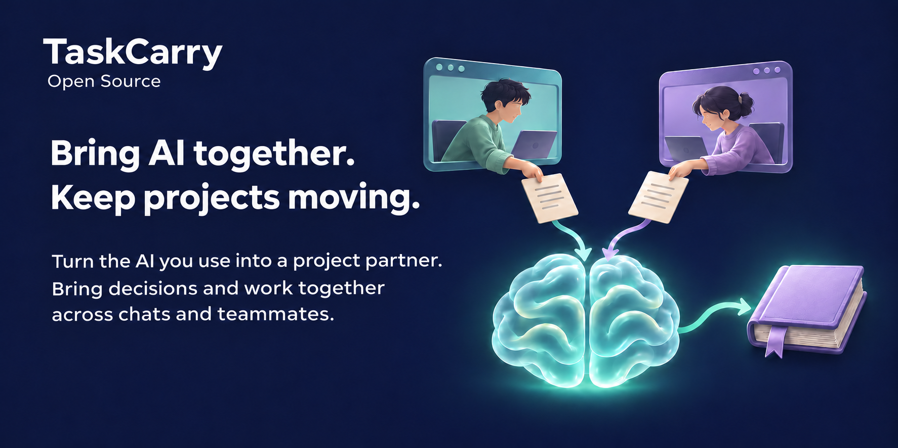

# TaskCarry

[English](README.md) · [简体中文](README.zh-CN.md) · [繁體中文](README.zh-TW.md)

**把 AI 組織起來，把專案做下去。**

TaskCarry 把你和同事在不同 AI 視窗裡的決定和成果接起來，存成專案的長期記憶。

[下載完整套件，三步開始](START_HERE.md#download) · [已有專案，更新與接續](docs/zh-TW/updating.md)

## TaskCarry 能幫你做什麼

### 要交付了，到底該發哪一版？

你在一個視窗改好展示，同事用自己的 AI 試了一遍，回你一句「這版可以發」。過兩天真要發給別人，「這版」是哪一份？問專案管家，它能把同事驗過的那份展示和當時的回饋一起找回來。

### 這件事，哪個視窗已經做過了？

上次測試無人機展示，同事留了句提醒：「先確認有沒有收到畫面。」這次輪到你和另一個 AI 檢查新版，螢幕上又是空的。管家找回那條提醒，你們就知道先查攝影機有沒有傳回畫面，再判斷前方有沒有障礙。

### 換個 AI，從上次停下的地方繼續

展示指南寫了一半，你想換個 AI 幫忙收尾。告訴新管家「接著寫這份指南」，它能從專案記錄裡找到上個視窗儲存的草稿、大家最後選的展示版本，以及同事標出來要補的那一步。你可以只交給它這份指南，也可以讓它接著管整個專案。

[本版更新與已演練的工作流程](docs/RELEASE_0.2.0.md#zh-tw)

## 已經有 Git 與專案指令，為什麼還需要 TaskCarry？

Git 儲存檔案歷史，AGENTS.md 等專案指令說明 AI 應該如何工作，交接摘要協助下一個對話進入狀態。TaskCarry 把這些既有工具與專案不斷變化的實際進度聯繫起來。

| 你已經在使用的工具 | 它解決什麼 | TaskCarry 補充什麼 |
|---|---|---|
| Git | 檔案版本、分支與修改歷史 | 成果屬於哪個任務、哪個階段已被接收、還有什麼需要繼續。 |
| AGENTS.md 與 Skills | 工作方法與角色說明 | 實際儲存、交付、彙入專案或暫停的工作記錄。 |
| 對話摘要 | 給人或下一個對話補充背景 | 可以持續更新、跨對話查閱的任務記錄與檔案位置。 |
| 手動交接 | 協調少量工作線 | 可檢查的接收計畫、實際操作記錄，以及中斷後已支援的接續方法。 |

一個對話中的短任務，既有工具可能已經足夠。當你需要反覆回答 **「上次停在哪裡？哪份成果是目前版本？什麼已經彙入專案？」** 時，TaskCarry 會更有幫助。

## 記住專案，協調成果，治理推進過程

### 記住專案

在對話之外儲存任務目標、已記錄的決定、目前位置與下一步。任務暫停時，儲存選定檔案與接續說明；查看目前事項時，也能保留暫停工作與已完成歷史。素材參照記錄大型檔案在哪裡，以及指定備份是否相符，不必把所有檔案都放進 Git。

**一個對話中斷，專案不必從頭來。** 治理可以引導新視窗沿原任務接續已儲存的決定與成果，無需預先建立空備用。先確認舊視窗停止寫入，再核對新視窗的連線與任務；這種接續依靠已儲存的工作，不修復宿主故障，也不恢復未儲存的上下文。詳見[接續操作說明](docs/zh-TW/operation-manual.md)。

### 協調成果

讓並行任務在獨立工作區推進，再將準備好的成果彙入共同版本。任務仍在繼續時，也能交付一個有用階段。明確的版本關係與相符的修改歷史說明新階段何時替代舊階段，同時保留獨立成果。

### 治理推進過程

專案工作流程治理透過清楚的計畫、經過校驗的更新與實際結果記錄，把人和 AI 推進的工作聯繫起來。

| 能力 | 對專案推進的幫助 |
|---|---|
| **理解已接入工作** | 複核選定來源的修訂，區分事實與判斷，保留決定和依賴，不重開已完成歷史。 |
| **讓工作視窗保持對齊** | 發布私有、版本化的工作台指導，保留專業指令與 Git WIP；分清已發布與視窗實際讀取。 |
| **接續完整治理整輪** | 保留責任、計畫效果、實際結果和中斷位置；透過早晨報告與安靜吸收時段持續維護。 |
| **接收精確階段成果** | 複核提交、路徑與任務關係後，將階段檔案彙入接收基線；另按計畫更新需要這些成果的工作區，保全支援範圍內的未完成工作。業務驗收由你決定。 |
| **恢復選定專案工作** | 驗證一致狀態/物件、原 Git 歷史和分層 WIP、明確素材與 standby 恢復，再決定唯一寫入權移交。 |
| **用證據維護與更新** | 問題關聯已驗證修正，發現新版與實際安裝分開，原始碼/原生宿主/自然觸發分別列證。 |

這裡的治理圍繞專案成果與工作流程展開。宿主權限與 Agent 身分驗證仍由 AI 平台與執行環境負責；[架構說明](docs/zh-TW/architecture.md)進一步介紹這些職責如何配合。

記憶來自你或 AI 助手明確接入的任務、說明、檔案與交付。TaskCarry 不會自動收集全部私人對話，也不會儲存編輯器中尚未寫入磁碟的內容。

## 人、AI 與工具如何配合？

獨立的**治理對話**維護專案記憶並複核已接入進展，使用宿主 AI 理解獲准來源、區分有效決定與建議，並呼叫 TaskCarry 工具。你可以選擇讓它兼任專案協調；也繼續直接在原主對話或專業對話中安排工作，不要求所有任務經治理分派。

產品按職責分為三層：**Core 內核**提供可驗證的共用操作；**能力層**包含隨包 Skills、專案方法與目前宿主工具；**使用者專案層**保留你的事實、決定、關係、檔案和進度。公共更新保留專案規則與記憶。Core 可以重裝，但恢復專案需要實際狀態、物件、Git 歷史/WIP、素材及能力版本。[三層架構說明](docs/zh-TW/architecture.md)解釋它們如何形成可接續的專案「大腦」。

內核程式、治理方法與專案資料分別管理：更新受支援的內核會沿用原任務與歷史關係；你自己的治理方法可以獨立驗證和採用，不必等待公共發行。

TaskCarry 儲存記錄並執行已支援的本機操作。你保留專案方向、優先順序、業務驗收與對外交付的決定權。工具不需要另設模型 API，也不訓練模型。

例如，軟體已經完成可用模組，實驗暫時暫停，文件還在起草。治理可以先接收軟體階段，再保留另外兩項任務的目前位置。儲存有用的進展，不需要把整個專案標成完成。

## 日常工作怎麼走？

你繼續在原來的專業視窗工作，總控整理決定、依賴關係和最新指引。下面的流程用於將一批穩定的 Git 成果彙入共同專案；一般進度記錄與規則更新不需要每次都交付或合併程式碼。

1. **在任務對話中工作。** 在分配好的工作區推進實際任務。
2. **儲存有用的暫停位置。** 暫停時記錄目前位置與選定檔案。
3. **交出準備好的成果。** 指明穩定版本與它修改的檔案。
4. **彙入共同專案。** 治理對話檢查計畫，透過工具接收這個階段。
5. **根據共同進度繼續。** 更新需要這些業務成果的工作區，保全支援範圍內的本機工作，並處理具體衝突。

一個階段被接收，不代表整個任務已經結束；暫停任務也可以繼續暫停。新階段替代舊階段需要明確關係與相符的修改歷史，獨立成果不會因為出現更新的檔案就被丟棄。

## 安裝或更新 TaskCarry

### 第一次使用 TaskCarry

[取得完整產品套件](START_HERE.md#download)，再依[三步上手手冊](docs/zh-TW/windows-example.md)完成：

1. **開一個專案管家對話。** 把 ZIP 解壓縮到一個空資料夾，按照[資料夾開啟方式與開場提示](docs/zh-TW/windows-example.md#install)開啟一個使用這個資料夾的管家對話。Codex 用 Windows **Ctrl+O** 或 Mac **⌘O（Command+O）** 選擇資料夾，再開啟新對話。
2. **讓工作對話加入。** 管家會直接給你一段加入提示。你可以從推薦的專案和對話中選，也可以跳過推薦，把提示直接貼到想加入的對話裡。加入後，各個對話都可以在原處繼續工作。以後想加新對話，告訴管家，它會給你提示與貼法。開啟定時治理後，管家會在下次檢查時收錄並告訴你誰加入了。想確認時，直接問「最近有哪些對話加入了？」
3. **開始工作，讓管家持續跟進。** 看管家整理的專案近況與下一步，回工作對話繼續。建議開啟定時治理，按需要讓管家協助設定 GitHub 私人儲存庫備份、其他 AI 或電腦協作，以及專案移轉。[查看回饋範例](docs/zh-TW/user-feedback-examples.md)。

繼續在原來的工作視窗推進。治理負責專案記憶，是否長期兼任專案協調由你選擇，新增專業視窗可以為零。

### 既有治理

（如果已安裝 TaskCarry、使用其他治理工具或已有治理對話，需要更新或接續，請參閱[更新與接續入口](docs/zh-TW/updating.md)。）入口區分套件更新與既有治理繼承，保留原記錄、設定及未完成工作。

需要你完成宿主操作時，助手只提供目前這一步。具體指令放在[手動後備](docs/zh-TW/manual-setup.md)，每次迭代變更了什麼集中在[本版更新](docs/RELEASE_0.2.0.md#zh-tw)。

這是一種組織範例，既有工作對話繼續有效。若它們共用目錄，先檢查活躍寫入者並保全相應 WIP，再安排獨立寫入範圍。

開啟[無人機模擬與治理實例](examples/vision-drone-governance/simulation/README.zh-TW.md)，可以看到零散對話如何協作形成軟體、演算法、硬體工程資料、獨立測試與產品展示。離線介面呈現規則偵測器讀取生成影像的像素，再引導無人機在 9 × 9 的離散二維場景中移動。實例提供共用決定、各角色交付與驗證證據；交付範圍是模擬原型，不包含實體無人機、實飛或訓練後的視覺模型。

## 從本機工作逐步擴充

- **標準本機治理：** 本機 Git、工作台發布/消費、首次完整整輪與恢復演練、官方版本檢查，以及每天兩個或三個原治理視窗時段：一個報告時段加一到兩個吸收時段。宿主缺步明確保留，發現新版先評估再決定安裝。
- **私有 Git：** 設定自己的遠端儲存庫，儲存選定且已提交的成果。素材參照協助定位檔案，複製、備份與遠端同步仍是明確進行的操作。
- **其他 AI 工具：** 能在本機啟動自訂 stdio MCP 服務的 AI 工具可以嘗試接入。Codex、WorkBuddy 和執行 Gemini 的 Google Antigravity CLI 已分別完成對應的專案操作。Gemini 網頁透過經授權的 HTTPS 入口，完成過指定專案資料的唯讀試驗。
- **多電腦：** 協作者將選定成果交到各自分支，整合管家核對後納入共同版本。換裝置時，可先在目標端還原專案、核對進度，再由你決定何時交接主寫。 [操作手冊](docs/zh-TW/remote-and-multicomputer.md)

TaskCarry 使用 Python 3.11+，包含安裝接入、任務交付、治理與恢復四類專案技能。標準上手準備本機 Git，底層一般檔案檢查點繼續提供相容與恢復能力。每個治理範圍使用一份本機狀態與一條接收基線；使用者定義的專案可以連接多個既有來源，保留各自身分。安裝更新的是工具與技能；把已接收的業務成果更新到工作區，是另一項需要檢查計畫的操作。詳見[維護說明](docs/zh-TW/governance-maintenance.md)與[實際能力範圍](docs/RELEASE_BOUNDARIES.md)。

## 文件

| 指南 | English | 简体中文 | 繁體中文 |
|---|---|---|---|
| 手動後備 | [Commands and handoffs](docs/en/manual-setup.md) | [手动后备](docs/zh-CN/manual-setup.md) | [手動後備](docs/zh-TW/manual-setup.md) |
| 操作手冊 | [Start here](docs/en/windows-example.md) | [从这里开始](docs/zh-CN/windows-example.md) | [從這裡開始](docs/zh-TW/windows-example.md) |
| 更新與接續 | [Update and continuation](docs/en/updating.md) | [更新与接续](docs/zh-CN/updating.md) | [更新與接續](docs/zh-TW/updating.md) |
| 使用者回饋範例 | [What users should hear](docs/en/user-feedback-examples.md) | [反馈示例](docs/zh-CN/user-feedback-examples.md) | [回饋範例](docs/zh-TW/user-feedback-examples.md) |
| 架構 | [How it works](docs/en/architecture.md) | [架构说明](docs/zh-CN/architecture.md) | [架構說明](docs/zh-TW/architecture.md) |
| 維護 | [Maintain a project](docs/en/governance-maintenance.md) | [维护项目](docs/zh-CN/governance-maintenance.md) | [維護專案](docs/zh-TW/governance-maintenance.md) |
| 私有 Git 與多電腦 | [Guide](docs/en/remote-and-multicomputer.md) | [说明](docs/zh-CN/remote-and-multicomputer.md) | [說明](docs/zh-TW/remote-and-multicomputer.md) |

[治理閉環如何變得更簡潔](docs/zh-TW/governance-evolution.md)

[CLI / MCP 參考](docs/COMMANDS.md) · [公開技能](skills) · [驗證記錄](docs/RELEASE_0.2.0.md)

## 一起改進

歡迎提問、分享實際情境、改善範例、翻譯或程式碼。可以從 [Issues](https://github.com/bryan123466/taskcarry/issues) 或[參與貢獻](https://github.com/bryan123466/taskcarry/blob/main/CONTRIBUTING.md)開始。分享前請移除私有專案內容；[安全說明](SECURITY.md)介紹哪些資料應保留在自己手中。

## 開源授權

公開程式碼、文件、範本與範例採用 [MIT 授權](LICENSE)，包含依條款進行商業複用的權利。自己的專案與資料仍由你管理，使用 TaskCarry 不會使它們公開。相依工具與服務適用各自條款，詳見[授權範圍](LICENSE_SCOPE.md)。
