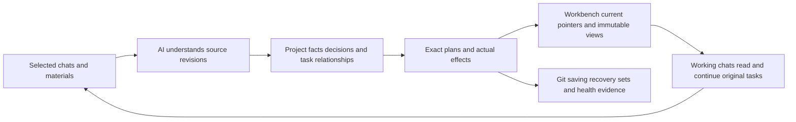

# How Core, the capability layer and your project work together

[Home](../../README.md) · [Three-step setup](windows-example.md) · [Recovery and multiple computers](remote-and-multicomputer.md) · [简体中文](../zh-CN/architecture.md) · [繁體中文](../zh-TW/architecture.md)

TaskCarry gives existing AI work a continuing governance workflow. Your governance chat uses its AI to understand authorized sources, retain traceable facts and decisions, deliver current guidance to relevant workbenches, and check saving and recovery coverage. Core supplies verifiable operations and records; AI supplies interpretation and judgment; you retain project direction, business acceptance and authorization. Governance may coordinate the project without becoming a mandatory dispatch gate.

## Three layers describe responsibilities, not three separate products

| Layer | Contents | What updates and recovery must retain |
|---|---|---|
| **Core: shared engine** | One engine behind CLI/MCP; identities, tasks, checkpoints, exact Git reception/adoption, fact revisions, governance cycles, workbench publication and recovery sets. | Exact version, package hash and compatibility requirements. Reinstall from trusted packages; reinstalling does not restore project data or upgrade a running environment automatically. |
| **Capability layer: how governance works** | Four packaged Skills and methods, plus host-provided chat reading, file access, native MCP, scheduling and delivery tools. Users can maintain their own methods. | Actual rules/Skills, source versions, customizations and required capability inventory. Verify host capabilities, connections and permissions again on a new machine. |
| **User project layer: what is governed** | Project identity, source routes, evidence and judgments, tasks/decisions/relationships, database and objects, workspace Git history and WIP, materials, recovery coverage, workbench views and actual receipts. | This cannot be recovered by downloading the product again. Capture consistent state, objects, Git layers and necessary materials under an explicit selection; disclose exclusions. |

One product can serve different projects. A public update offers changes to shared tools or methods; your governance evaluates applicability, compatibility and risk while preserving project rules and memory. Release discovery, recorded fixes, installation and host loading are separate stages. Your host supplies the AI model and account. TaskCarry does not train models or require a separate model API.

## How one project brain absorbs progress from many chats

One brain means maintained project identity, rules, relationships and governance records, not a copied model or identical context in every chat. Stable source/fact identities distinguish matching names; aliases and revisions preserve earlier facts. Observing a file, understanding its contents, publishing guidance and a working chat consuming it are separate evidence stages. Superseded decisions retain provenance; a new date does not revive completed history as backlog.

Core `source_scan` performs bounded metadata enumeration of an explicitly authorized local root, retaining pages, exclusions and incomplete states. Reading chat bodies or material contents requires the appropriate host tools and permission, followed by AI interpretation. A prompt cannot create missing access. Unread sources or incomplete directories do not justify claims that content is absent or finished.

## A governance cycle has an owner, effects and a continuation point

Each `cycle` binds the original task, owner and exact resources. The tools retain intended operations before actual-result evidence. Process locks coordinate cooperating local writers; durable reservations retain responsibility after interruption. Retry verifies completed effects and finishes missing supported receipts or steps. A local conflict preserves its work while independent work can continue.

Fact records separate source statements, evidence and AI judgments. Health has observation times and validity windows; absent or expired evidence is not healthy. Necessary questions record actual delivery and follow up on distinct dates, avoiding repeated same-day prompts. Use one daily report slot plus one or two absorption slots; no substantive changes can end quietly. Native scheduling wakes the original governance chat; Core is not a resident AI or scheduling service.

## Deliver guidance without replacing professional work

`workbench` freezes an immutable view with source revisions, then plans against registered workspaces, original tasks, Git identity and exact file hashes. A current pointer selects the published view; live task state remains in Core. Source drift is visible, so an old view is not presented as current truth.

The Codex adapter changes only its managed developer_instructions section, retaining professional text, other MCP services, model and permission settings. Default entries must be ignored private files, preventing local paths or project data from being written into tracked/staged public files. Navigation changes do not advance Git HEAD, rewrite the index or alter unrelated WIP. Publication receipts and consumption evidence remain separate; a successful write does not attest host loading, understanding or business acceptance.

## Business results retain exact delivery semantics

A checkpoint saves selected files and continuation context. A stable stage identifies original base/commit and the complete changed-path list. Governance reviews a reception plan; workspaces needing the business changes explicitly adopt them. Saving is not delivery; reception is not business acceptance; a governance-method update does not merge business code. Paused tasks remain paused, and independent stages are not overwritten because another file has a newer date.

Shared defects need shared implementation and regression verification, with experience linked to applicable versions and actual adoption. Unknown failures require effect inspection first. An experience or fix record does not install a correction. Source tests, standalone stdio, current-host native tools and natural scheduling are distinct evidence layers.

## What must be backed up to restore the project

Include the registered receiving repository when the project already has one. Recovery verifies and rebinds that repository and accepted-stage locations while retaining the original records. Later work uses new plans belonging to the restored replica. A missing receiving repository makes coverage incomplete; an old computer's path is not presented as a usable restored baseline.

**Core can be reinstalled; capabilities must be reproducible; your project layer needs actual backups.** A selected recovery set captures consistent database state, necessary objects, selected Git refs/history/index/WIP, explicit materials and capability versions. Ordinary project files and external large materials require explicit coverage. Unsaved editor buffers, private platform chats, credentials and host permissions are not captured automatically.

An independently restored replica starts in `standby`. Verify bytes, path rebinding, tasks and workspaces, then regenerate local connections and verify native tools. Activate a new sole governance writer only after explicitly stopping the old writer and checking the exact handoff target. Host/Git controls must enforce an offline old writer's exclusion; a local lock cannot prove a remote process stopped.

Parallel work on other computers uses separate task branches or exact file artifacts, returning source identities, versions, paths and continuation points to one governance writer. **Do not concurrently synchronize a live SQLite database or share `.git`.** Private remote/cloud transport is separate; local capture, upload, download and isolated restore each need evidence. See the [multi-computer reference](remote-and-multicomputer.md).
