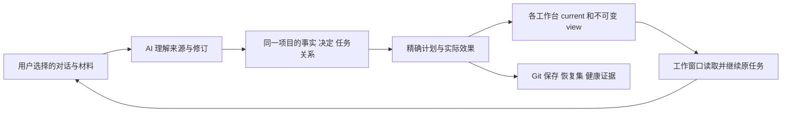

# Core、能力层与用户项目层如何一起工作

[首页](../../README.zh-CN.md) · [三步上手](windows-example.md) · [恢复与多电脑](remote-and-multicomputer.md) · [English](../en/architecture.md) · [繁體中文](../zh-TW/architecture.md)

TaskCarry 让现有 AI 对话中的工作形成持续的项目治理。总控利用你正在使用的 AI 理解授权来源，维护可追溯事实和决定，把共同进度与规则送回相关工作台，并核对保存与恢复能力。Core 提供可靠操作与记录；AI 负责理解和判断；你决定项目方向、业务验收及授权边界。治理可以兼任项目协调，但不是你分派每件工作的必经入口。

## 三层是职责划分，不是三个需要分别购买的产品

| 层 | 包含什么 | 更新和恢复时保留什么 |
|---|---|---|
| **Core：共享内核** | CLI/MCP 同引擎，身份、任务、检查点、精确 Git 接收/采用、事实修订、治理整轮、工作台发布、恢复集等可验证操作。 | 记录精确版本、包哈希和兼容要求；可从可信包重装。重装内核不会找回用户状态，也不自动升级运行环境。 |
| **能力层：治理怎么做** | 随包提供的四项 Skills、规则与流程，加上当前宿主提供的对话读取、文件访问、原生 MCP、调度和送达工具；用户可维护自己的方法。 | 保存实际使用的规则/Skills 及来源版本、定制内容和所需能力清单。另一台机器要重新核对宿主能力、连接与权限。 |
| **用户项目层：治理什么** | 项目身份、来源路由、事实与判断、任务/决定/关系、数据库与对象、工作区 Git 历史和 WIP、材料及备份覆盖、工作台 view 和实际回执。 | 这是不能只靠重新下载产品恢复的部分。按明确范围保存一致状态、对象、Git 分层和必要材料；标出未包含内容。 |

同一份产品可以服务完全不同的项目。公共更新是共享工具或方法的候选改进；你的治理根据兼容性、实际问题和风险判断是否需要采用，保留项目规则与记忆。发现官方版本、形成修正记录、实际安装和宿主加载是不同阶段。AI 模型与平台账户由你的宿主提供，TaskCarry 不训练模型，也不要求另购模型 API。

## 一个“大脑”如何吸收多个窗口的推进

“同一个大脑”指持续维护的项目身份、规则、关系和治理记录，不是复制一份模型或让所有窗口共享完整上下文。稳定 source/fact 身份区分同名任务和材料；别名及修订关系保留旧事实。观察到文件、理解内容、发布指导、工作窗口消费分别有证据。旧决定被新决定取代时保留来源，不因新日期重建历史积压。

Core 的 `source_scan` 只对明确授权的本地根目录做有界元数据扫描，保留分页、排除项和未完成状态。读取聊天正文或材料内容需要宿主的对应工具及授权，再由 AI 理解；提示词不会创造缺失的权限。没有读到的来源、没有扫描完的目录不能推断为不存在或已完成。

## 一次治理有开始、效果和接续位置

每轮 `cycle` 绑定原任务、所有者和明确资源范围。工具先保留操作意图，再保存实际结果；进程锁协调本机合作写入，持久预留保留中断后的责任。重试先检查已生效部分，补未完成的回执或步骤。局部冲突保留相关工作，独立工作可继续。

事实记录把来源陈述、证据和 AI 判断分开；健康记录有观察时间与有效期，过期或缺失不算健康。必要询问记录真实送达，按不同日期计算跟进，避免同一天重复执行就不断追问。每天一个报告时段，加一到两个吸收时段；无实质变化可以安静结束。定时工具唤起原治理聊天，Core 本身不是常驻 AI 或调度服务。

## 规则送到工作台，不覆盖专业工作

`workbench` 先冻结带来源修订的不可变 view，再根据登记工作区、原任务、Git 身份及文件哈希生成计划。当前指针只表示正在发布使用的视图，原状态仍以 Core 为准。来源变动会显示漂移，不能把旧 view 当成实时事实。

Codex 适配只更新受管 developer_instructions 段，保留专业文本、其他 MCP 服务、模型和权限设置。默认入口必须是 Git 忽略的私有文件，不能把本机路径或项目资料写入 tracked/staged 的公开文件。Git HEAD、index 和无关 WIP 不因导航更新改变。发布回执与消费证据分开；写入成功不等于窗口加载、读懂或业务验收。

## 业务成果仍保留原有精确交付语义

检查点保存选定文件与接续位置；稳定阶段以原 base/commit 和完整路径清单交付；接收前检查计划；需要业务改动的工作区再显式采用。已保存不等于已交付，已接收不等于业务验收，更新治理方法不等于合并业务代码。暂停任务保持暂停，独立阶段不会被仅凭日期较新的文件覆盖。

公共问题应由共享实现和回归验证解决，经验记录关联适用版本与实际采用。未知错误先核对实际效果；记录经验或 fix 不是安装修复。CLI、独立 stdio、当前宿主原生连接及自然定时分别列证，不能彼此冒充。

## 备份什么，才能恢复这个项目

如果项目已有用于汇总成果的接收仓库，恢复集也要包含它。恢复后会核对并重绑这个仓库及已接收阶段的当前位置，保留原始记录；后续成果使用属于新副本的新计划继续接收。缺少接收仓库时会明确报告覆盖不完整，不沿用旧电脑路径冒充可继续工作。

**Core 可以重装，能力层需要可重建，用户项目层必须有实际备份。** 一份恢复集按清单保存一致数据库、必要对象、选定 Git refs/历史/index/WIP、明确材料及能力版本；普通项目文件和外部大材料需明确纳入。未保存编辑器缓冲、平台私有聊天、凭证和宿主权限不会自动包含。

恢复到独立目录后，副本默认 `standby`，先验证字节、路径重绑定、任务与工作区，再重新生成本机连接并验收原生工具。只有明确停止旧写入者、完成交接与目标副本核验后，才启用新的唯一治理写入点。离线旧主机的实际权限隔离仍需宿主/Git 服务保障；本机锁不能证明远端旧进程已停。

异地并行工作使用各自任务分支或精确文件产物，把来源、版本、路径和未完位置交给唯一治理写入点吸收。**不同时同步写入活跃 SQLite 数据库或共享 `.git`。** 私有远端和网盘传输是单独动作；本地清单、上传、下载及隔离恢复分别验证。[多电脑参考](remote-and-multicomputer.md)说明完整边界。
