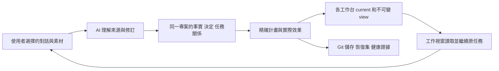

# Core、能力層與使用者專案層如何一起工作

[首頁](../../README.zh-TW.md) · [三步上手](windows-example.md) · [恢復與多電腦](remote-and-multicomputer.md) · [English](../en/architecture.md) · [简体中文](../zh-CN/architecture.md)

TaskCarry 讓既有 AI 對話中的工作形成持續的專案治理。總控利用你正在使用的 AI 理解授權來源，維護可追溯事實和決定，把共用進度與規則送回相關工作台，並核對儲存與恢復能力。Core 提供可靠操作與記錄；AI 負責理解和判斷；你決定專案方向、業務驗收及授權邊界。治理可以兼任專案協調，但不是你分派每件工作的必經入口。

## 三層是職責劃分，不是三個需要分別購買的產品

| 層 | 包含什麼 | 更新和恢復時保留什麼 |
|---|---|---|
| **Core：共用內核** | CLI/MCP 同引擎，身分、任務、檢查點、精確 Git 接收/採用、事實修訂、治理整輪、工作台發布、恢復集等可驗證操作。 | 記錄精確版本、包雜湊和相容要求；可從可信包重裝。重裝內核不會找回使用者狀態，也不自動升級執行環境。 |
| **能力層：治理怎麼做** | 隨包提供的四項 Skills、規則與流程，加上目前宿主提供的對話讀取、檔案存取、原生 MCP、調度和送達工具；使用者可維護自己的方法。 | 儲存實際使用的規則/Skills 及來源版本、客製內容和所需能力清單。另一台機器要重新核對宿主能力、連線與權限。 |
| **使用者專案層：治理什麼** | 專案身分、來源路由、事實與判斷、任務/決定/關係、資料庫與物件、工作區 Git 歷史和 WIP、素材及備份覆蓋、工作台 view 和實際回執。 | 這是不能只靠重新下載產品恢復的部分。按明確範圍儲存一致狀態、物件、Git 分層和必要素材；標出未包含內容。 |

同一份產品可以服務完全不同的專案。公共更新是共用工具或方法的候選改進；你的治理依相容性、實際問題和風險判斷是否需要採用，保留專案規則與記憶。發現官方版本、形成修正記錄、實際安裝和宿主載入是不同階段。AI 模型與平台帳戶由你的宿主提供，TaskCarry 不訓練模型，也不要求另購模型 API。

## 一個「大腦」如何吸收多個視窗的推進

「同一個大腦」指持續維護的專案身分、規則、關係和治理記錄，不是複製一份模型或讓所有視窗共用完整上下文。穩定 source/fact 身分區分同名任務和素材；別名及修訂關係保留舊事實。觀察到檔案、理解內容、發布指導、工作視窗消費分別有證據。舊決定被新決定取代時保留來源，不因新日期重建歷史積壓。

Core 的 `source_scan` 只對明確授權的本機根目錄做有界中繼資料掃描，保留分頁、排除項和未完成狀態。讀取對話正文或素材內容需要宿主的對應工具及授權，再由 AI 理解；提示詞不會創造缺失的權限。沒有讀到的來源、沒有掃描完的目錄不能推斷為不存在或已完成。

## 一次治理有開始、效果和接續位置

每輪 `cycle` 綁定原任務、擁有者和明確資源範圍。工具先保留操作意圖，再儲存實際結果；程序鎖協調本機合作寫入，持久預留保留中斷後的責任。重試先檢查已生效部分，補未完成回執或步驟。局部衝突保留相關工作，獨立工作可繼續。

事實記錄把來源陳述、證據和 AI 判斷分開；健康記錄有觀察時間與有效期，過期或缺失不算健康。必要詢問記錄真實送達，按不同日期計算跟進，避免同一天重複執行就不斷追問。每天一個報告時段，加一到兩個吸收時段；無實質變化可以安靜結束。定時工具喚起原治理對話，Core 本身不是常駐 AI 或調度服務。

## 規則送到工作台，不覆蓋專業工作

`workbench` 先凍結帶來源修訂的不可變 view，再依登記工作區、原任務、Git 身分及檔案雜湊產生計畫。目前指標只表示正在發布使用的檢視，原狀態仍以 Core 為準。來源變動會顯示漂移，不能把舊 view 當成即時事實。

Codex 適配只更新受管 developer_instructions 區段，保留專業文字、其他 MCP 服務、模型和權限設定。預設入口必須是 Git 忽略的私有檔案，不能把本機路徑或專案資料寫入 tracked/staged 的公開檔案。Git HEAD、index 和無關 WIP 不因導覽更新改變。發布回執與消費證據分開；寫入成功不等於視窗載入、讀懂或業務驗收。

## 業務成果仍保留原有精確交付語義

檢查點儲存選定檔案與接續位置；穩定階段以原 base/commit 和完整路徑清單交付；接收前檢查計畫；需要業務改動的工作區再顯式採用。已儲存不等於已交付，已接收不等於業務驗收，更新治理方法不等於合併業務程式碼。暫停任務保持暫停，獨立階段不會被僅憑日期較新的檔案覆蓋。

公共問題應由共用實作和迴歸驗證解決，經驗記錄關聯適用版本與實際採用。未知錯誤先核對實際效果；記錄經驗或 fix 不是安裝修復。CLI、獨立 stdio、目前宿主原生連線及自然定時分別列證，不能彼此冒充。

## 備份什麼，才能恢復這個專案

如果專案已有用於彙整成果的接收儲存庫，恢復集也要包含它。恢復後會核對並重綁該儲存庫及已接收階段的目前位置，保留原始記錄；後續成果使用屬於新副本的新計畫繼續接收。缺少接收儲存庫時會明確回報覆蓋不完整，不沿用舊電腦路徑冒充可繼續工作。

**Core 可以重裝，能力層需要可重建，使用者專案層必須有實際備份。** 一份恢復集按清單儲存一致資料庫、必要物件、選定 Git refs/歷史/index/WIP、明確素材及能力版本；普通專案檔案和外部大型素材需明確納入。未儲存編輯器緩衝、平台私有對話、憑證和宿主權限不會自動包含。

恢復到獨立目錄後，副本預設 `standby`，先驗證位元組、路徑重新綁定、任務與工作區，再重新產生本機連線並驗收原生工具。只有明確停止舊寫入者、完成交接與目標副本核驗後，才啟用新的唯一治理寫入點。離線舊主機的實際權限隔離仍需宿主/Git 服務保障；本機鎖不能證明遠端舊程序已停。

異地並行工作使用各自任務分支或精確檔案產物，把來源、版本、路徑和未完位置交給唯一治理寫入點吸收。**不同時同步寫入活躍 SQLite 資料庫或共用 `.git`。** 私有遠端和網路硬碟傳輸是單獨動作；本機清單、上傳、下載及隔離恢復分別驗證。[多電腦參考](remote-and-multicomputer.md)說明完整邊界。
