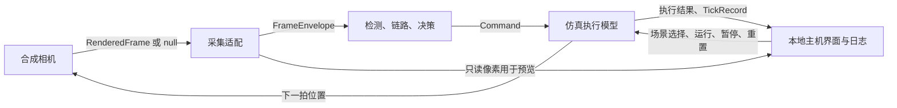

# RC8 v2 接口与概念接线规划

本规划适用于 `rc8-drone-sim-v2` 工程资料。相机角色、处理节点、主机界面和执行模型在本版仿真中交换内存帧与消息。候选物理端口用于后续台架选型。

## 仿真接口方向

| 来源 → 接收方 | 概念端口 | 时序与核对 |
| --- | --- | --- |
| 合成相机 → 采集适配 | 帧输出 → 帧输入 | 每个 100 ms 逻辑拍交付一份 160 × 120 RGBA8 内存帧或 `null`。带帧时附 `frame_id`、尺寸、格式与长度为 76,800 的像素数组。 |
| 采集适配 → 处理节点 | 帧封装输出 → 检测输入 | 先封装当拍 `FrameEnvelope`，再读取图像。取原始像素用于检测和摘要，检测框和文字由呈现层绘制。 |
| 处理节点 → 仿真执行模型 | 决策消息输出 → 命令输入 | `Command` 携带拍号、来源帧号、动作与原因，每拍在链路状态更新后交付。无帧或坏帧交付 `HOLD`。 |
| 仿真执行模型 → 合成相机、日志及界面 | 状态输出 → 次拍位置与记录输入 | 反馈执行后位置供下一拍渲染，汇集碰撞、到达与运行状态形成同拍日志。保持动作维持位置和访问计数。 |
| 主机界面 → 仿真运行管理 | 操作输入 | 场景选择、运行、暂停、恢复和重置由本地主机操作。运行状态及日志回传可用于核对操作生效。 |

## 后续台架概念端口

| 节点 | 信号方向和端口用途 | 供电与参考地 | 选型待确认项 |
| --- | --- | --- | --- |
| 相机／独立帧源 | 帧数据输出 → 处理节点采集输入。若所选接口支持配置，处理节点发往相机的配置与相机返回的状态另行定义。 | 台架电源向相机供电，电流经回流端返回供电源。相机侧参考电位按所选数据接口的要求记录。 | 帧源型号、输出协议与数据方向、电平、时钟或同步支持、连接件及引脚定义。 |
| 处理节点 | 采集端接收帧数据。主机侧输出结果与状态，接收主机运行设置。执行侧以软件消息交付 `Command`。 | 台架电源向处理节点供电。记录处理节点本地参考地、数据回流路径以及与相机侧参考电位的关系。 | 采集与主机链路接口、电平兼容、采样时钟、供电容量、启动时序及连接件。 |
| 主机界面 | 主机接收结果、状态和日志，向运行管理送操作，界面预览消费只读像素。若后续采用独立处理节点，按其主机链路定义收发端口。 | 主机由自身供电路径供电。外接处理节点时，核对主机链路参考电位与物理边界。 | 主机连接方式、物理端口、线缆、屏蔽与隔离需求。 |
| 仿真执行模型 | 处理节点发送 `Command` → 仿真执行输入。模型返回位置与状态 → 次拍生成、界面和日志。 | 软件模型随主机运行，接口通过进程内调用。 | 后续若另行评估实物执行机构，需独立界定执行接口、供电与限值。 |

## 供电、地与隔离核对

- **供电路径。** 工程图后续标出供电源、各负载的供电方向、回流、预期负载及浪涌条件。额定电压、允许纹波、电流与热限值待器件选择和测量。
- **参考地与信号。** 为每段信号注明发送端、接收端、局部参考地及返回路径。采用同一参考域时，按所选接口核对共同参考和回流。信号电平、共模范围、线序和连接件待器件资料确认。
- **跨域隔离。** 按最终电源域和通信类型评估隔离边界，注明各侧本地参考地、隔离方向和隔离侧供电范围。隔离方式、器件和限值待选型。
- **时标。** 仿真使用 100 ms 逻辑拍。台架待确定采集打点、触发方向或同步通道、时钟域及主机时标对齐方法，以支持逐帧时延测量。

完成选型后再形成可复核的引脚表、供电与隔离图及连接件清单。故障停留逻辑和后续台架记录口径见 [硬件工程说明](HARDWARE_ENGINEERING.md)。
